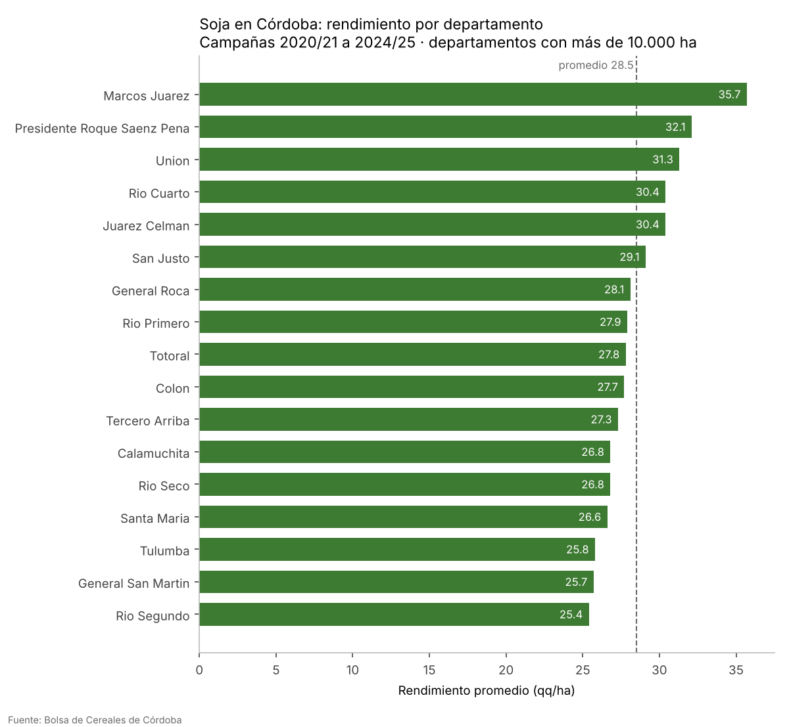
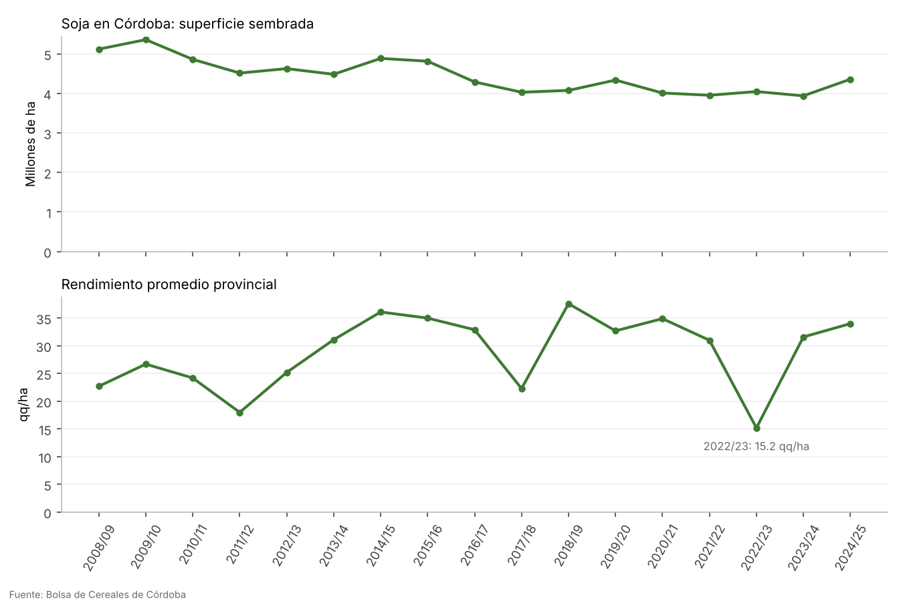

# Soja en Córdoba: rendimiento por departamento

Análisis en Python de 17 campañas de soja (2008/09 a 2024/25) en los departamentos de Córdoba, con datos de la Bolsa de Cereales de Córdoba, integrado con un mapa en QGIS para identificar las zonas más productivas y más estables.

**Autor:** Agustín Escobar · [LinkedIn](https://www.linkedin.com/in/agustin-escobar-05322825a/)



## Principales resultados

- **El sudeste lidera en rendimiento.** Marcos Juárez (35,7 qq/ha), Presidente Roque Sáenz Peña (32,1) y Unión (31,3) encabezan el promedio de las últimas cinco campañas, frente a un promedio de 28,5 qq/ha entre los departamentos con más de 10.000 ha.
- **Marcos Juárez es además el más estable:** su rendimiento varía un 19,7 % entre campañas, el valor más bajo de la provincia.
- **La superficie de soja cayó un 15 %** en el período: de 5,12 millones de ha en 2008/09 a 4,36 millones en 2024/25.
- **La sequía de 2022/23 se ve con claridad:** el rendimiento provincial bajó a 15,2 qq/ha y la producción a 5,2 millones de toneladas, menos de la mitad de una campaña normal.
- **La soja se desplaza hacia el norte.** Mientras Río Cuarto (−29 %) y Marcos Juárez (−23 %) redujeron superficie, Río Seco (+71 %) y Tulumba (+43 %) la aumentaron. Pero son los departamentos con rendimiento más inestable (39 % y 41 % de variación), es decir, de mayor riesgo productivo.



## Qué hace el script

1. Lee las tres hojas del Excel de la Bolsa (superficie, rendimiento y producción) y las une en una sola tabla.
2. Limpia los nombres de departamentos (mayúsculas, sin acentos, unifica variantes como "GRAL. SAN MARTIN").
3. Filtra Córdoba y el cultivo elegido.
4. Calcula por departamento: superficie y producción promedio de las últimas campañas, rendimiento reciente e histórico, variabilidad del rendimiento (coeficiente de variación) y cambio de superficie sembrada.
5. Genera una tabla para unir en QGIS y dos gráficos.

## Datos

- **Estadística de Cultivos**, Bolsa de Cereales de Córdoba: [bccba.org.ar/estadisticas-de-cultivos](https://www.bccba.org.ar/estadisticas-de-cultivos/), enlace "Descarga de datos". Se permite su reproducción citando la fuente.
- **Límites de departamentos**: capa "Departamento" del [Instituto Geográfico Nacional](https://www.ign.gob.ar/NuestrasActividades/InformacionGeoespacial/CapasSIG).

## Cómo correrlo

```bash
pip install -r requirements.txt
python soja_cordoba.py BCCBA_ESTADISTICA_CULTIVOS.xlsx
```

Opciones:

- `--cultivo MAIZ` analiza otro cultivo del archivo (MAIZ, TRIGO, MANI, GIRASOL, SORGO…).
- `--campanias 3` cambia cuántas campañas recientes se promedian (por defecto, 5).
- `--min-ha 20000` cambia la superficie mínima para entrar al ranking (por defecto, 10.000 ha).

Resultados en la carpeta `salida/`:

| Archivo | Contenido |
| --- | --- |
| `soja_cordoba_por_departamento.csv` | Una fila por departamento, para unir en QGIS |
| `soja_cordoba_evolucion.csv` | Totales de Córdoba por campaña |
| `rendimiento_por_departamento.png` | Ranking de rendimiento |
| `evolucion_provincial.png` | Superficie y rendimiento por campaña |

## Unir los resultados al mapa en QGIS

1. Abrí la capa de departamentos del IGN y filtrala a Córdoba.
2. Con la calculadora de campos, creá un campo `depto_norm` con el nombre en mayúsculas y sin acentos, por ejemplo: `upper(replace(replace(replace(replace(replace("nam",'á','a'),'é','e'),'í','i'),'ó','o'),'ú','u'))` (cambiá `"nam"` por el campo de nombre de tu capa; agregá `'ñ','n'` si hace falta).
3. Arrastrá `soja_cordoba_por_departamento.csv` al panel de capas.
4. En la capa de departamentos: **Propiedades → Uniones → +**, capa a unir el CSV, campo de unión `departamento`, campo de destino `depto_norm`.
5. **Simbología → Graduado** sobre `rendimiento_qq_ha`, 5 clases, rampa de verdes.
6. Superponé la capa de zonas de la Bolsa de Cereales con contorno y sin relleno.
7. Exportá el mapa con el **Diseñador de impresión** (título, leyenda, escala y fuente) como PNG.

Otra idea de mapa: pintar `cambio_sembrada_pct` con una rampa divergente (rojo = bajó, verde = subió) para ver el corrimiento de la soja hacia el norte.

## Herramientas

Python (pandas, matplotlib) · QGIS · datos abiertos de la BCCBA y el IGN
